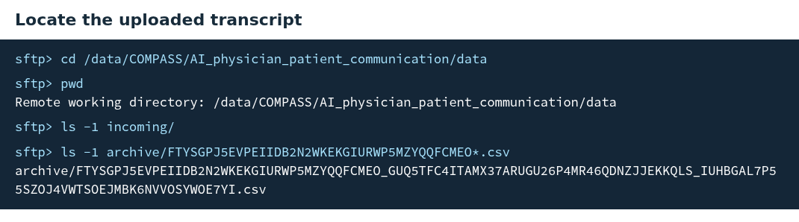
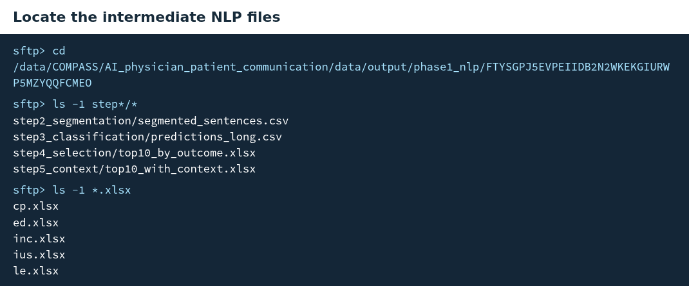
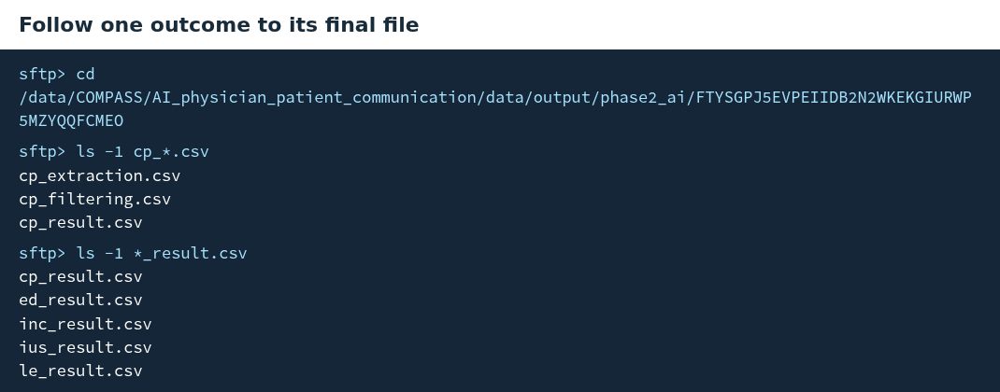

# How to Find Inputs, Intermediate Files, and Final Results for a COMPASS Production AI Pipeline Run Using SFTP

Start with the filename shown on the COMPASS upload page and the patient folder ID supplied by your lead. After connecting in step 1, use this table to choose where to look. All folders are under `/data/COMPASS/AI_physician_patient_communication/data/`.

| What do you want to find? | Where to look |
|---|---|
| The CSV I just uploaded | Open `incoming/` and look for the exact filename from the upload page. After successful processing, the file moves to `archive/`. |
| How the pipeline split and scored the transcript | Open `output/phase1_nlp/`, then the assigned patient folder. Step 3B lists the files in processing order. |
| How the AI produced a particular result | Open the same patient folder under `output/phase2_ai/`. For cancer prognosis, follow `cp_extraction.csv`, then `cp_filtering.csv`, then **`cp_result.csv`**. |

**For each assignment**, have the exact uploaded filename and patient folder ID ready. In the commands below, replace `SOURCE_FILENAME` with the full filename (including `.csv`) and `PATIENT_FOLDER_ID` with the folder ID supplied by your lead. You are done when you can record the final file path alongside the assigned analysis number.

### Your first file lookup

1. Sign in using the jump-server command or SSH profile in section 1. At the **sftp>** prompt, enter the section 1 data-folder command. Type `pwd` to confirm where you are.
2. For the input, run `ls -l incoming/` and look for the filename on the upload receipt. For a successful completed run, type `ls -l archive/SOURCE_FILENAME`, replacing **SOURCE_FILENAME** with the whole uploaded name, including its extension.
3. For intermediate files, copy the two commands in section 3B. Replace **PATIENT_FOLDER_ID** in each with the coded patient folder for your run. Keep the asterisks: they list all matching files. Check for the segmentation CSV and the outcome workbooks.
4. For final results, use the commands in section 3C with the **same patient folder ID**. For the cancer-prognosis example, locate `cp_extraction.csv`, `cp_filtering.csv` and `cp_result.csv`. For another outcome, use its code from section 3C.
5. Record the analysis number and the full path to the final file. If the patient has repeat runs, use the time check in section 2 before recording a match. Type `bye` when finished.

## 1. Connect from your workstation

Obtain your approved jump-server and COMPASS login details from the access owner. Ask for both hostnames, both usernames, the SSH ports, the host key fingerprints, and the remote data folder visible to your account. Use your own assigned access.

Open Terminal or PowerShell on the approved network. If IT supplied an SSH profile that already includes the jump server, type `sftp PROFILE_NAME`, replacing `PROFILE_NAME` with that profile. Otherwise, replace the uppercase fields below with the values from IT and run:

```text
sftp -J JUMP_USER@JUMP_HOST:JUMP_PORT -P COMPASS_PORT COMPASS_USER@COMPASS_HOST
```

On first connection, compare each host key fingerprint with the one supplied by IT before accepting it. Complete the prompted sign-in. When you see **sftp>**, enter the following commands one line at a time. If your account has a restricted folder layout, use the equivalent data folder supplied by IT for the first command.

```text
cd /data/COMPASS/AI_physician_patient_communication/data
pwd
```

Stay in this folder for the rest of the guide. In the commands below, `ls -l` lists filenames, sizes and modification times. It leaves the files in place.

## 2. Match your assignment to a folder

For a new assignment, ask the validation lead for the **analysis number**, **patient folder ID**, **source filename**, and **run time in UTC**. If all you have is an analysis number, the lead can look up its row in `public.transcript_analysis_log` using `id` and return `patient_id`, `source_filename` and `pipeline_started_at`.

The two output folders use the patient ID. A repeat run for the same patient writes to the same filenames. If there are multiple runs, ask the lead to match the source name, UTC time and file timestamps against the run record. If an earlier version has been overwritten, request a retained copy for that run before reporting a match.

## 3. Follow your assigned run from input to final result

After replacing the placeholders, enter one command at a time at the **sftp>** prompt.

**A. Find the uploaded input.** When the production dashboard accepts a prepared CSV through **Admin → Upload** (`/admin/upload`), the backend writes it to:

```text
/data/COMPASS/AI_physician_patient_communication/data/incoming/<uploaded-filename>.csv
```

Look for the exact name shown as queued on the upload page. A name ending in `.csv.part` means the file is still arriving. Once the upload finishes, it appears with its original `.csv` name.

From the data folder selected in step 1, check the live queue:

```text
ls -l incoming/
```

Look for the queued name. The watcher moves the input to `archive/` on successful processing or to `error/` after a processing failure. An empty queue is therefore expected after completion. For a completed run, look up the archived input by its exact filename:

```text
ls -l archive/SOURCE_FILENAME
```




These panels show reformatted SFTP output for a synthetic case collected locally on the production server with the service account. Use your assigned patient identifier. Here the processed input CSV is in `archive/`.

**B. Follow the NLP phase.** The first command lists the four intermediate files. The second lists the five outcome workbooks. For example, `cp.xlsx` holds the selected cancer-prognosis sentences and context that feed the AI phase.

```text
ls -l output/phase1_nlp/PATIENT_FOLDER_ID/step*/*
ls -l output/phase1_nlp/PATIENT_FOLDER_ID/*.xlsx
```




The first listing shows the intermediate files by NLP step. In the second listing, find the workbook for your outcome, such as `cp.xlsx` for cancer prognosis.

| Stage | File to look for |
|---|---|
| Sentence segmentation | `step2_segmentation/segmented_sentences.csv` |
| Classifier predictions | `step3_classification/predictions_long.csv` |
| Top sentences by outcome | `step4_selection/top10_by_outcome.xlsx` |
| Selected sentences with surrounding text | `step5_context/top10_with_context.xlsx` |
| NLP output by outcome | `cp.xlsx`, `inc.xlsx`, `ed.xlsx`, `ius.xlsx`, `le.xlsx` |

The pipeline reads the input and filters the doctor's speech before segmentation. Its first standalone intermediate file in this folder is the step 2 CSV.

**C. Find the AI intermediates and final file.** Follow one outcome all the way through. For cancer prognosis, use:

```text
ls -l output/phase2_ai/PATIENT_FOLDER_ID/cp_*.csv
```

Look for **cp_extraction.csv** (extracted candidates), **cp_filtering.csv** (filtered candidates), and **cp_result.csv** (final AI output for this outcome). The same three suffixes apply to `inc` (continence), `ed` (erectile function), `ius` (irritative urinary symptoms) and `le` (life expectancy). Each available outcome has its own final CSV. List the final files present for your assigned patient folder:

```text
ls -l output/phase2_ai/PATIENT_FOLDER_ID/*_result.csv
```




For cancer prognosis, follow `cp_extraction.csv` and `cp_filtering.csv` to the final file, `cp_result.csv`. The second listing shows the final files for all five outcomes.

Record the analysis number, outcome and remote path of the final file in your validation notes. Type `bye` to disconnect.

## What each stage produces

The production dashboard accepts a prepared, de-identified transcript CSV. Its `speaker` column identifies who spoke and `text` holds the utterance. The queued file, archived file and failed input represent different locations in the life of that upload. PostgreSQL records the upload receipt in `admin_upload_log`.

| Stage | What to look for and how to read it |
|---|---|
| Read input and identify the doctor | The watcher reads the transcript and keeps the doctor's utterances for segmentation. The parsed input and filtered rows are saved in PostgreSQL as the `raw` and `filtered` snapshots. There is no separate doctor-only CSV in the output folder. |
| Segment and classify | In `segmented_sentences.csv`, use `index` to follow a sentence, `i` for its utterance and `i2` for its position within that utterance. In `predictions_long.csv`, each sentence has five outcome score columns. |
| Rank and add context | `top10_by_outcome.xlsx` groups the top-ranked sentences by outcome. `top10_with_context.xlsx` adds the surrounding text. The five outcome workbooks contain the selected sentences, classifier score (`.pred_1`) and context. The running pipeline passes these data to the AI stage in memory and writes the workbooks as exports. |
| Score and extract | Within each outcome, the AI scores the candidates and extracts estimates. Open the corresponding `*_extraction.csv`. Read `score` and `score_explanation` for the AI assessment, `estimate` for the extracted estimate and, where applicable, `treatment`. The scoring step has no separate CSV. |
| Filter | `*_filtering.csv` contains the remaining candidates. The filter keeps the highest scores, removes duplicate estimates and handles treatment groups separately when present. Use the extraction file to see which candidates entered this step. |
| Select and reformat | `*_result.csv` combines the selected evidence and reformatted output. Look for `selection_explanation` and `selection_index` when present, and `reformat` for the final wording. Side-effect outcomes can have a row per selected treatment. Selection and reformatting share this result file. |

**Which results live in PostgreSQL?** For an authorized database review, match the analysis number to `transcript_analysis_log.id`. This record includes the source filename, original uploaded bytes in `xlsx_data` (including for CSV input), processing metadata and the overall AI score when computed. The overall score is a database field, `ai_overall_score`. For stage detail, use the same run's `analysis_id` in the tables below.

| Database table | Run-specific contents |
|---|---|
| `nlp_pipeline_intermediate` | Four snapshots identified by `step`: `raw`, `filtered`, `sentences` and `top_by_model`. |
| `nlp_all_predictions` and `sentence_prediction` | All sentence-level model scores in the first table, selected sentences with their scores and context in the second. |
| `llm_pipeline_intermediate` | Candidate rows after AI extraction. Use the filtering CSV for the post-filter candidate list. |
| `llm_domain_scoring_and_summary` | Final selected evidence by outcome, score, explanation, estimate, treatment where applicable, source context and reformatted summary. |

The pipeline also ensures a `patient_summary` record exists for the source file and speaker. It serves as a reference for patient-facing records. A complete five-outcome run like the verified example produced **24 output files**: four NLP intermediates, five NLP workbooks and fifteen AI CSVs (three per outcome). This count excludes the input. An interrupted or AI-skipped run can have fewer files. A failed watcher run can additionally produce a per-input `.error.log` and a shared `error_log.txt` under `error/`.

## If a file is missing

| What you see | What to check |
|---|---|
| Timeout or login failure before **sftp>** | Tell the access owner which host or sign-in prompt failed. Confirm the approved network, jump profile and account. |
| **Permission denied** or **No such file** on the data folder | Run `pwd` and ask for the data folder as exposed to your account, with read and directory traversal access. |
| No exact match under `archive/` | For a queued run, the source may still be in `incoming/`. Failed inputs may be in `error/`. Duplicate archive names can gain a suffix such as `_1.csv`. Confirm the matching run with the lead. Placing a file in `incoming/` can start processing. |
| NLP workbooks exist but no AI results | Ask the lead to check whether the run completed with AI enabled. File presence alone cannot confirm successful database persistence. |

**Verification record · November 27, 2026.** The live upload directory was confirmed against the running backend and watcher settings. The file patterns in this guide were checked against a completed synthetic run using the host’s local SFTP subsystem. Michael’s access through the jump server still needs to be verified from his workstation.
