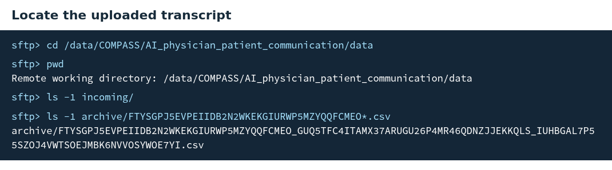
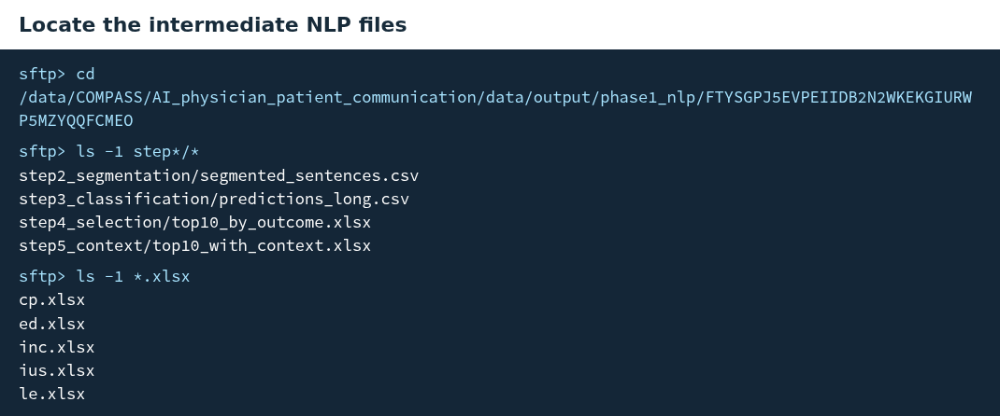
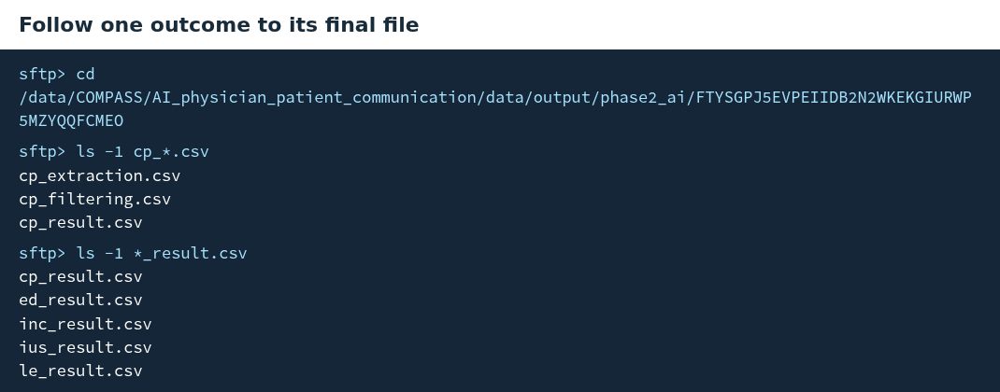

# SFTP로 COMPASS 운영 AI 파이프라인의 입력 파일, 중간 산출물, 최종 결과 찾기

준비할 것은 **COMPASS 업로드 화면에 표시된 파일명**과 **검증 담당자가 알려 준 환자 폴더 ID**입니다. 아래 경로는 모두 `/data/COMPASS/AI_physician_patient_communication/data/`를 기준으로 합니다.

| 찾으려는 파일 | 확인할 위치 |
|---|---|
| 방금 업로드한 CSV | `incoming/`에서 업로드 화면과 같은 이름을 찾습니다. 처리가 성공하면 파일이 `archive/`로 이동합니다. |
| 문장을 나누고 분류한 결과 | `output/phase1_nlp/` 아래의 환자 폴더를 엽니다. 3단계 B에 처리 순서대로 파일명이 정리돼 있습니다. |
| AI가 특정 항목의 결과를 만든 과정 | `output/phase2_ai/` 아래에서 같은 환자 폴더를 엽니다. 예를 들어 암 예후는 `cp_extraction.csv` → `cp_filtering.csv` → **`cp_result.csv`** 순서로 확인합니다. |

아래 명령에서 `SOURCE_FILENAME`은 **확장자 `.csv`까지 포함한 업로드 파일명**으로, `PATIENT_FOLDER_ID`는 **배정받은 환자 폴더 ID**로 바꿔 입력하세요. 목표는 배정된 분석 번호에 해당하는 최종 파일을 찾아 그 경로를 기록하는 것입니다.

## 1. 내 컴퓨터에서 접속하기

접속 담당자에게 승인된 네트워크, 점프 서버(경유 서버)와 COMPASS 서버 각각의 주소·사용자명·SSH 포트·호스트 키 지문, 그리고 내 계정에서 보이는 데이터 폴더 경로를 받으세요.

승인된 네트워크에서 터미널이나 PowerShell을 엽니다. IT 담당자가 점프 서버까지 설정된 SSH 프로필을 제공했다면 `sftp PROFILE_NAME`에서 `PROFILE_NAME`을 받은 이름으로 바꿔 실행합니다. 개별 접속 정보를 받았다면 아래 명령의 대문자 부분을 바꿉니다.

```text
sftp -J JUMP_USER@JUMP_HOST:JUMP_PORT -P COMPASS_PORT COMPASS_USER@COMPASS_HOST
```

처음 접속할 때는 화면에 표시된 각 서버의 호스트 키 지문이 IT 담당자에게 받은 값과 일치하는지 확인한 뒤 연결을 승인합니다. 본인 계정으로 로그인해 **sftp>**가 보이면 다음 명령을 한 줄씩 입력하세요. 내 계정에서 보이는 경로가 다르면 첫 줄에 담당자가 알려 준 경로를 사용합니다.

```text
cd /data/COMPASS/AI_physician_patient_communication/data
pwd
```

`pwd`는 현재 폴더를 보여 줍니다. 이후 명령은 이 폴더에서 실행합니다. `ls -l`은 파일 이름, 크기, 마지막 수정 시각을 보여 주는 조회 명령입니다.

## 2. 분석 번호와 환자 폴더 연결하기

검증 담당자에게 **분석 번호, 환자 폴더 ID, 업로드 파일명, 실행 시각(UTC)**을 받으세요. 분석 번호만 있다면 담당자가 DB의 `public.transcript_analysis_log`에서 `id`로 해당 건을 찾아 `patient_id`, `source_filename`, `pipeline_started_at`을 확인할 수 있습니다.

두 출력 폴더 모두 환자 ID를 사용합니다. 같은 환자를 다시 처리하면 같은 경로와 파일명에 결과가 기록됩니다. 실행이 여러 건이라면 담당자와 함께 원본 파일명, 실행 시각, 파일 수정 시각을 실행 기록과 대조하세요. 이전 파일이 덮어써졌다면 해당 실행의 보관 사본을 확인한 후 일치 여부를 기록합니다.

## 3. 입력부터 최종 결과까지 찾기

아래 명령에서 파일명과 환자 폴더 ID를 바꾼 뒤 **sftp>**에 한 줄씩 입력하세요.

### A. 업로드한 입력 CSV 찾기

운영 대시보드의 **Admin → Upload**(`/admin/upload`)에서 준비한 CSV를 올리면 서버가 다음 위치에 저장합니다.

```text
/data/COMPASS/AI_physician_patient_communication/data/incoming/<uploaded-filename>.csv
```

업로드 화면에 대기 중(`queued`)으로 표시된 이름을 찾으세요. 전송 중에는 파일명이 `.csv.part`로 끝나고, 전송이 끝나면 원래 `.csv` 이름으로 표시됩니다. 대기 폴더는 다음 명령으로 확인합니다.

```text
ls -l incoming/
```

처리가 성공하면 입력 파일은 `archive/`로, 처리에 실패하면 `error/`로 이동합니다. 완료 후에는 대기 폴더가 비어 있을 수 있습니다. 성공한 실행의 입력 파일은 다음과 같이 찾습니다.

```text
ls -l archive/SOURCE_FILENAME
```




세 그림은 운영 서버에서 서비스 계정으로 조회한 합성 예시의 SFTP 출력을 정리한 것입니다. 본인에게 배정된 환자 식별자로 조회하세요. 이 예시에서는 처리된 입력 CSV가 `archive/`에 있습니다.

### B. 자연어 처리(NLP) 단계의 중간 파일 찾기

첫 줄은 단계별 중간 파일 4개를, 둘째 줄은 결과 항목별 Excel 파일 5개를 조회합니다. 예를 들어 `cp.xlsx`에는 다음 AI 단계에서 사용할 암 예후 관련 문장과 그 앞뒤 문맥이 들어 있습니다.

```text
ls -l output/phase1_nlp/PATIENT_FOLDER_ID/step*/*
ls -l output/phase1_nlp/PATIENT_FOLDER_ID/*.xlsx
```




첫 번째 목록에서 NLP 단계별 중간 파일을 찾으세요. 두 번째 목록은 항목별 파일입니다. 예를 들어 암 예후는 `cp.xlsx`입니다.

| 확인하려는 내용 | 파일 |
|---|---|
| 분리된 문장 | `step2_segmentation/segmented_sentences.csv` |
| 문장별 분류 예측 | `step3_classification/predictions_long.csv` |
| 항목별로 선택된 상위 문장 | `step4_selection/top10_by_outcome.xlsx` |
| 선택된 문장과 앞뒤 문맥 | `step5_context/top10_with_context.xlsx` |
| 항목별 NLP 결과 | `cp.xlsx`, `inc.xlsx`, `ed.xlsx`, `ius.xlsx`, `le.xlsx` |

파이프라인은 입력에서 의사의 발화를 골라낸 뒤 문장을 분리합니다. 이 폴더에서 개별 파일로 확인할 수 있는 첫 중간 산출물은 2단계의 문장 분리 CSV입니다.

### C. AI 단계의 중간 파일과 최종 결과 찾기

한 항목을 골라 끝까지 따라갑니다. 암 예후(`cp`)를 확인한다면 다음 명령을 사용하세요.

```text
ls -l output/phase2_ai/PATIENT_FOLDER_ID/cp_*.csv
```

`cp_extraction.csv`에는 추출한 후보가, `cp_filtering.csv`에는 필터링한 후보가, **`cp_result.csv`**에는 암 예후의 최종 AI 결과가 들어 있습니다. 다른 항목도 같은 파일명 규칙을 따릅니다. `inc`는 요자제(소변 조절), `ed`는 발기 기능, `ius`는 자극성 배뇨 증상, `le`는 기대 여명입니다. 다음 명령은 해당 환자 폴더에서 최종 결과 CSV만 모아 보여 줍니다.

```text
ls -l output/phase2_ai/PATIENT_FOLDER_ID/*_result.csv
```




암 예후의 중간 파일은 `cp_extraction.csv`와 `cp_filtering.csv`입니다. 최종 파일은 `cp_result.csv`입니다. 두 번째 목록에서 다른 항목의 최종 파일도 찾을 수 있습니다.

검증 기록에 **분석 번호, 확인한 항목, 최종 파일의 서버 경로**를 적으세요. 작업이 끝나면 `bye`를 입력해 연결을 종료합니다.

## 각 단계에서 만들어지는 결과 읽기

운영 대시보드에 올리는 입력은 미리 비식별 처리한 전사 CSV입니다. `speaker` 열에는 발화자, `text` 열에는 발화 내용이 들어갑니다. 대기·보관·오류 폴더는 업로드한 파일이 처리 상태에 따라 머무는 위치입니다. PostgreSQL의 `admin_upload_log`에는 업로드 접수 이력이 기록됩니다.

| 단계 | 결과에서 확인할 내용 |
|---|---|
| 입력 읽기·의사 발화 선별 | 입력을 읽고 의사의 발화를 골라 문장 분리 단계로 넘깁니다. DB에는 읽어 들인 전체 행이 `raw`, 선별한 행이 `filtered`로 저장됩니다. 출력 폴더에 의사 발화 전용 CSV가 따로 생기지는 않습니다. |
| 문장 분리·분류 | `segmented_sentences.csv`에서 `index`는 문장 식별용 번호, `i`는 발화 번호, `i2`는 해당 발화 안의 문장 위치입니다. `predictions_long.csv`에서는 문장 한 줄마다 다섯 항목의 분류 점수를 볼 수 있습니다. |
| 상위 문장 선정·문맥 추가 | `top10_by_outcome.xlsx`에서 항목별 상위 문장을, `top10_with_context.xlsx`에서 그 문장의 앞뒤 문맥을 봅니다. 항목별 Excel 파일 5개에는 선택 문장, 분류 점수(`.pred_1`), 문맥이 들어갑니다. 운영 파이프라인은 이 데이터를 메모리에서 AI 단계로 전달하고 Excel 파일은 확인용으로 내보냅니다. |
| AI 채점·추출 | 해당 항목의 `*_extraction.csv`에서 `score`는 AI 점수, `score_explanation`은 채점 이유, `estimate`는 추출한 추정값입니다. 치료법을 구분하는 항목에는 `treatment`도 있습니다. 채점만 담은 별도 CSV는 없습니다. |
| 후보 필터링 | `*_filtering.csv`에는 높은 점수의 후보를 남기고 중복 추정값 등을 정리한 결과가 담깁니다. 치료법이 있으면 그룹별로 처리합니다. 필터링 전후를 비교할 때는 같은 항목의 추출 CSV와 대조하세요. |
| 최종 후보 선택·문장 정리 | `*_result.csv`에는 선택된 근거와 최종 문장이 함께 들어갑니다. `selection_explanation`과 `selection_index`가 있으면 선택 이유와 선택 위치를, `reformat`에서는 최종 표현을 확인하세요. 부작용 항목은 선택된 치료법마다 행이 생길 수 있습니다. 선택과 문장 정리는 같은 결과 파일에 기록됩니다. |

**DB에서 확인하는 결과**도 있습니다. DB 조회 권한이 있다면 분석 번호를 `transcript_analysis_log.id`와 대조하세요. 이 기록에는 원본 파일명, 업로드 파일의 바이트(`xlsx_data`, CSV 입력도 이 필드에 저장), 처리 정보, 산출된 경우 종합 AI 점수(`ai_overall_score`)가 있습니다. 아래 테이블은 같은 실행의 `analysis_id`로 연결합니다.

| DB 테이블 | 해당 실행에서 저장하는 내용 |
|---|---|
| `nlp_pipeline_intermediate` | `step` 값에 따라 입력 전체(`raw`), 의사 발화(`filtered`), 분리 문장(`sentences`), 모델별 상위 문장(`top_by_model`)을 구분합니다. |
| `nlp_all_predictions`, `sentence_prediction` | 앞 테이블에는 전체 문장의 모델별 점수, 뒤 테이블에는 선택된 문장·점수·문맥이 저장됩니다. |
| `llm_pipeline_intermediate` | AI 추출 직후의 후보 행입니다. 필터를 통과한 후보 목록은 필터링 CSV에서 확인합니다. |
| `llm_domain_scoring_and_summary` | 항목별 최종 근거, 점수, 설명, 추정값, 해당 시 치료법, 원문 문맥, 정리된 문장을 저장합니다. |

이와 별도로 파이프라인은 원본 파일·발화자 조합에 대한 `patient_summary` 레코드를 확보해 환자 화면의 관련 기록을 연결합니다. 확인한 다섯 항목 전체 실행에서는 **입력 파일을 제외하고 산출 파일 24개**가 생성됐습니다. NLP 중간 파일 4개, 항목별 Excel 5개, AI CSV 15개(항목당 3개)입니다. 중단되거나 AI를 생략한 실행에서는 수가 달라질 수 있습니다. 처리 실패 시 `error/`에는 입력별 `.error.log`와 공통 `error_log.txt`도 기록될 수 있습니다.

## 파일을 찾지 못했을 때

| 화면에 보이는 상황 | 확인할 사항 |
|---|---|
| **sftp>**가 뜨기 전에 시간 초과 또는 로그인 실패 | 어느 서버나 로그인 단계에서 멈췄는지 접속 담당자에게 알리고, 네트워크·점프 서버 프로필·계정을 확인하세요. |
| 데이터 폴더에서 **Permission denied** 또는 **No such file** 표시 | `pwd`로 현재 위치를 확인하세요. 담당자에게 내 계정에서 보이는 데이터 경로와 그 경로에 들어가 파일 목록을 읽을 권한이 있는지 문의하세요. |
| `archive/`에 같은 이름이 없음 | 대기·처리 중이면 `incoming/`, 실패했으면 `error/`를 확인하세요. 보관 시 이름이 겹치면 `_1.csv`처럼 번호가 붙을 수 있습니다. 담당자와 실행 건을 대조하세요. `incoming/`에 파일을 넣으면 처리가 시작될 수 있습니다. |
| NLP Excel 파일은 있지만 AI 결과가 없음 | 담당자에게 해당 실행에서 AI 단계가 활성화됐는지, 처리가 완료됐는지 확인하세요. 파일이 보이는 것만으로는 DB 저장 성공 여부까지 알 수 없습니다. |

**검증 기록 · 2026년 11월 27일.** 실행 중인 백엔드와 대기 폴더 감시 서비스의 설정을 대조해 실제 업로드 위치를 확인했습니다. 완료된 합성 실행 건으로 서버의 로컬 SFTP에서 위 파일명 패턴을 확인했습니다. Michael의 컴퓨터에서 본인 계정으로 점프 서버를 거쳐 같은 경로에 접근할 수 있는지는 별도 확인이 필요합니다.
