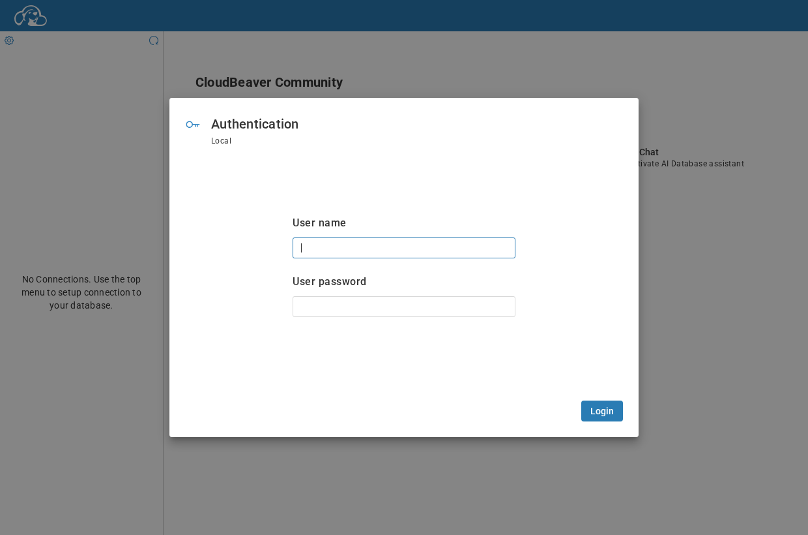
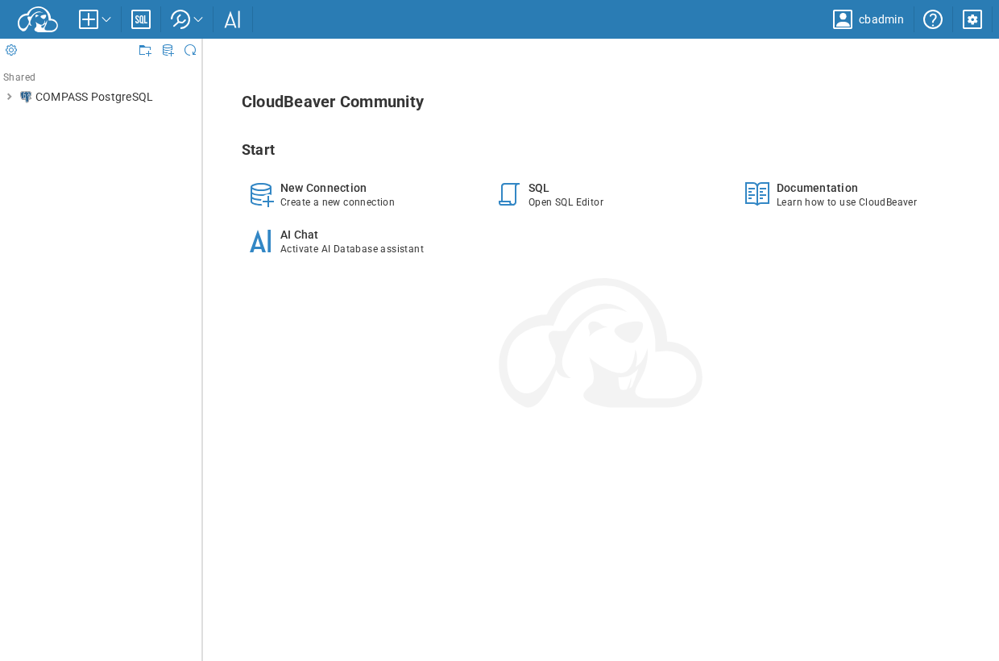
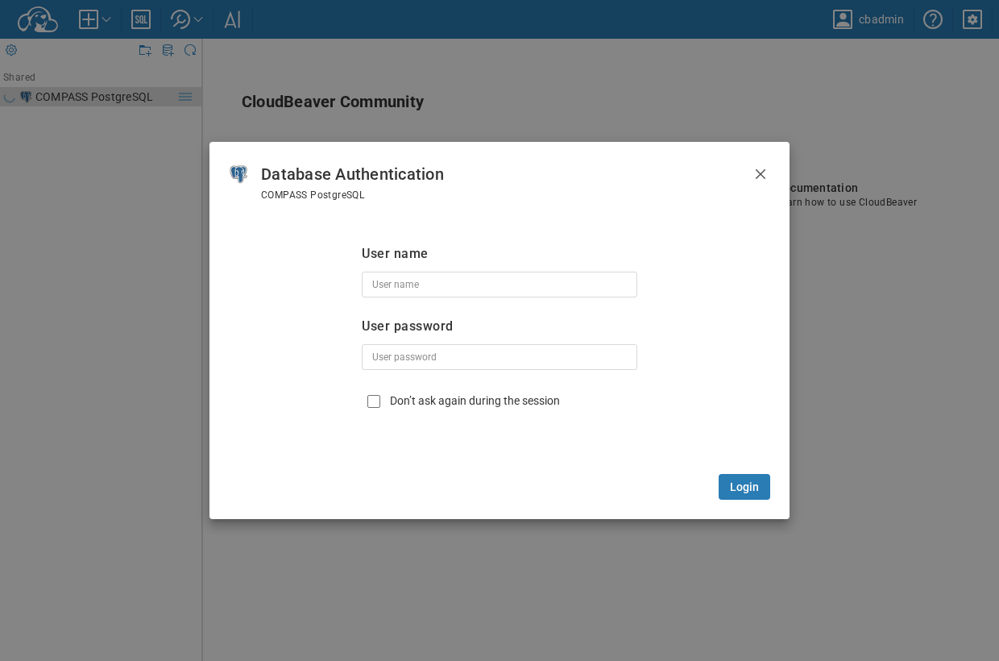
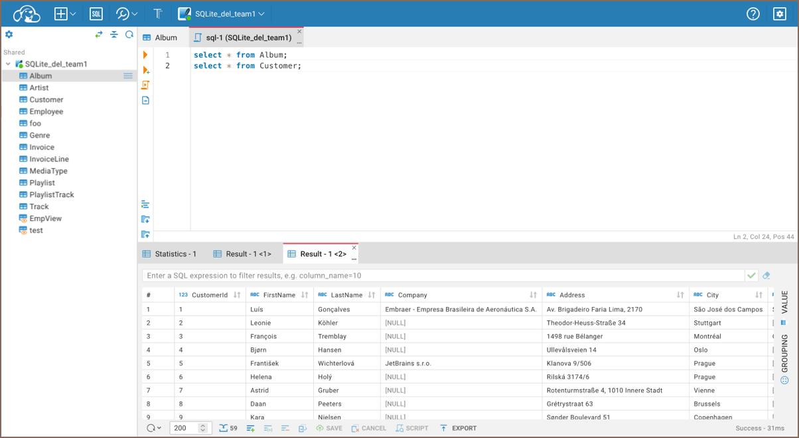
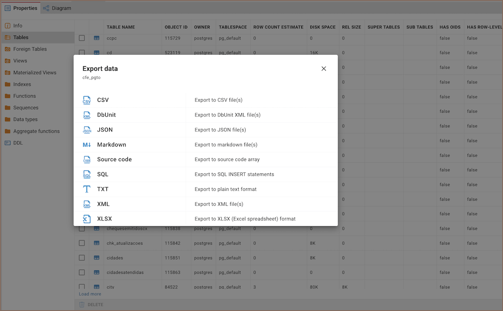
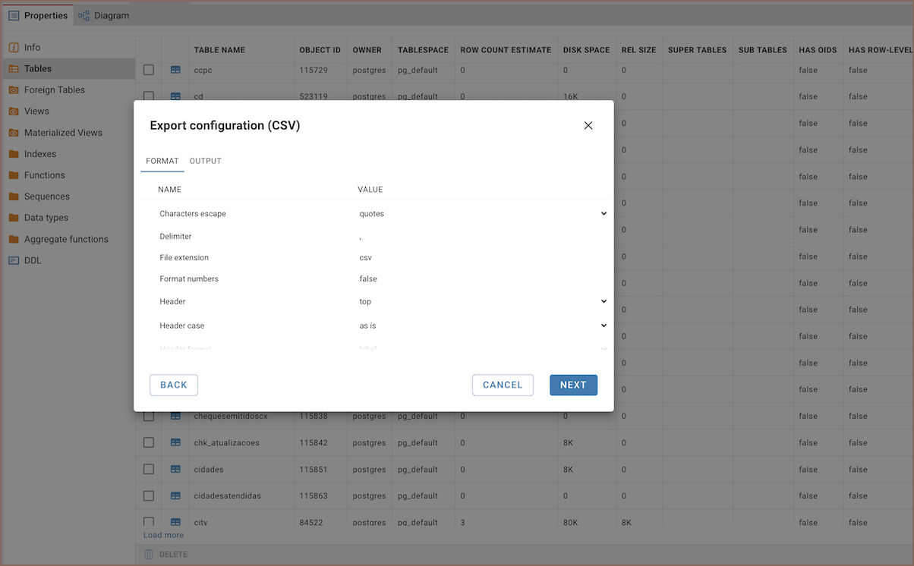

# COMPASS validation team guide: Review AI results in CloudBeaver and export a CSV

Use CloudBeaver to look up existing runs in the production PostgreSQL database, review their AI scores, and export the displayed results. You can start with a single run.

### Your first case

Have your web login, database login, assigned patient code and expected outcome ready. Follow sections 1–5 in order the first time.

1. Open the COMPASS website and sign in. Open **Shared → COMPASS PostgreSQL** and enter your database credentials.
2. Run the connection check in section 1. Check that the result says **prostatecancer_db_native** and shows your database username.
3. Run the section 3 lookup. Find your assigned patient and copy the **analysis_number** for the run you are reviewing. If several runs match and you do not know which one was assigned, confirm the run with the lead.
4. Paste the section 4 lookup and replace only **12345** with the number you copied. Execute it and read **domain**, **treatment** and **recorded_score** on the same row.
5. From that results grid, choose **Export data → CSV → Export → Download**. Open the downloaded file and match one row to the grid using the analysis number, domain, treatment and score. This completes the first-case check.

## 1. Sign in and confirm your connection

1. Join the network specified by your lead and open [COMPASS CloudBeaver](https://compassdb.hlpgonzalezlab.com/). CloudBeaver runs in the browser. The database connection is already configured. At **Authentication**, enter your personal **web account** and click **Login**.

   

2. In the left panel under **Shared**, double-click **COMPASS PostgreSQL**. The screenshots were captured on the COMPASS server with an administrator web session. Your own account name and available toolbar buttons may differ.

   

3. At **Database Authentication**, enter the **PostgreSQL username and password** assigned to you and select **Login**. This second prompt may appear when you first open the SQL editor.

   

4. Select **COMPASS PostgreSQL**, then **SQL → Open SQL Editor**. Paste the line below into the editor, click inside it and select **Execute SQL statement** (the play button beside the editor). Read the single row in the results grid.

   ```sql
   SELECT current_database() AS database_name, current_user AS signed_in_as;
   ```

   **Success:** the first cell says `prostatecancer_db_native` and the second shows your assigned database role. If the page returns 403 before login, confirm the approved network. If the connection is missing after web login, ask the lead to check shared connection access. For a table permission error, give the lead the table name.

## 2. Where each pipeline stage is stored

Use the coded `patient_id` to identify the patient. Use `public.transcript_analysis_log.id` to identify the exact run. Its value appears as `analysis_id` in the result tables. The table map below describes the source data in the public schema. The queries below use the production tables directly and select the individual columns available to the reviewer role.

| What you need | Table and filter | What you will find |
|---|---|---|
| Upload receipt | `admin_upload_log`, by queued filename and upload time | Whether the app accepted the file. An upload receipt alone does not establish analysis completion. |
| Run identity and overall score | `transcript_analysis_log`, by `patient_id` and `id` | Source filename, start time, processing status and `ai_overall_score`. |
| Transcript preparation and sentence selection | `nlp_pipeline_intermediate`, by `analysis_id` and `step` | Snapshots for `raw`, `filtered` (doctor speech), `sentences` and `top_by_model`. |
| NLP model predictions | `nlp_all_predictions`, by `analysis_id` | Sentence-level scores for the five outcomes. |
| NLP sentences selected for review | `sentence_prediction`, by `analysis_id` and `model` | Top sentences, classifier score and surrounding context. |
| AI extraction candidates | `llm_pipeline_intermediate`, by `analysis_id`, `domain` and `step='extraction'` | Candidate scores, explanations and extracted estimates. The post-filter candidate list is available in the pipeline's filtering CSV. |
| Final score for an outcome | `llm_domain_scoring_and_summary`, by `analysis_id`, `domain` and, where applicable, `treatment` | Selected score, explanation, estimate and reformatted summary. A run can have multiple treatment rows for one outcome. |

**What the reviewer account can read.** On November 27, 2026, the operator verified column-level read access under `clinical_teams` in production. Across all stored runs, the role could read six upload receipts, six runs with original upload bytes in `transcript_analysis_log.xlsx_data`, six snapshots for each of the four NLP steps, 1,230 sentence prediction rows in `nlp_all_predictions`, 300 selected sentence rows in `sentence_prediction`, 300 AI extraction rows, and 33 final result rows. These counts describe that day's inventory. For a single case, use its analysis number and expect counts specific to that run.

**Where to check filtering.** The NLP snapshot named `filtered` contains the doctor's utterances selected early in transcript preparation. Later, the AI filters candidates for each outcome. To compare the candidates before and after that later step, open `<domain>_extraction.csv` and `<domain>_filtering.csv` under `data/output/phase2_ai/<patient-folder-ID>/` in the production AI project. The database stores extraction candidates and final selections. The full post-filter candidate list is available in the filtering CSV. [COMPASS pipeline SFTP guide](./COMPASS_AI_PIPELINE_SFTP_GUIDE.md)

The five outcome codes are **cp** (cancer prognosis), **le** (life expectancy), **ed** (erectile function), **inc** (continence) and **ius** (irritative urinary symptoms).

## 3. Find a production analysis

Select **COMPASS PostgreSQL**, open the SQL editor and run the following statement. Each row identifies a stored analysis. Look for the coded patient ID for your review and note the matching analysis number. A patient may have several runs.

```sql
SELECT patient_id, id AS analysis_number, processed, ai_overall_score
FROM public.transcript_analysis_log
ORDER BY id DESC;
```

## 4. Read the final scores

Replace **12345** with the analysis number you just identified. For several assigned runs, enter their numbers separated by commas inside the parentheses. Click **Execute SQL statement**.

```sql
SELECT r.patient_id, r.id AS analysis_number, r.processed, r.ai_overall_score,
       s.domain, s.treatment, s.ai_score AS recorded_score,
       CASE WHEN s.analysis_id IS NULL THEN 'No final result'
            WHEN s.ai_score IS NULL THEN 'Missing score'
            ELSE 'Score returned' END AS lookup_status
FROM public.transcript_analysis_log AS r
LEFT JOIN public.llm_domain_scoring_and_summary AS s
       ON s.analysis_id = r.id AND s.patient_id = r.patient_id
WHERE r.id IN (12345)
ORDER BY r.id, s.domain, s.treatment;
```

Confirm the patient ID and analysis number against your review assignment. Compare the domain, treatment and score on the same row with the expected result. A recorded zero is a numeric score. A blank score or absent expected domain needs follow-up. An empty grid means none of the entered run numbers matched a visible analysis.




Look below the SQL for the results grid. The screenshot shows the vendor’s sample database. In COMPASS, look for **analysis_number**, **domain** and **recorded_score**. [CloudBeaver SQL Editor](https://dbeaver.com/docs/cloudbeaver/SQL-Editor/)

## 5. Export the displayed results and verify the file

1. Select the **results grid below the final-scores query**. Open **Export data** from the result grid's actions or context menu. Starting from this grid keeps your analysis-number filter in the export.
2. Choose **CSV**. Set **Header** to **top** and use a comma delimiter. In **Output**, choose **UTF-8**. Select **Export**, then **Download** when the file is ready. Save it to the team's approved review folder. The product guide illustrates the format and output dialogs. [CloudBeaver export screenshots](https://dbeaver.com/docs/cloudbeaver/Data-export/#steps-to-export-data)

   

   Select **CSV**. [CloudBeaver export guide](https://dbeaver.com/docs/cloudbeaver/Data-export/#steps-to-export-data)


   

   Check the header and delimiter before exporting. This is the settings dialog from the [CloudBeaver export guide](https://dbeaver.com/docs/cloudbeaver/Data-export/#steps-to-export-data).

3. Open the CSV in your spreadsheet application, importing the patient ID as text. Check that it contains the expected columns, including **patient_id**, **analysis_number**, **domain**, **treatment**, **recorded_score** and **lookup_status**. Compare one known row with the browser grid.
4. In a **copy** of the spreadsheet, keep the patient ID and analysis number columns together and remove duplicate **pairs**. Compare the resulting list with the assignment roster in both directions. For an assignment covering 50 patients with one run each, expect 50 distinct patients and 50 matching pairs. For one case, expect the single assigned pair. The original CSV can have many more rows because each run has multiple outcomes and treatments.
5. Filter the original CSV by **lookup_status** to find exceptions. Record the assignment reference, export date, matched patient count, missing or extra domains, and comparison outcome. Mark an inaccessible or incomplete case **Unable to verify**.

## Validation lead: before distributing the guide

Give reviewers their personal web login, assigned PostgreSQL login, the cases to review, an independently expected score and the approved export location.

**Verification.** On November 27, 2026, the operator tested direct production reads under the effective PostgreSQL role `clinical_teams`. An export of existing linked scores returned 33 rows from six runs across four coded patient IDs. That inventory includes a known synthetic run. Reviewer sign-in and CSV download from the reviewers' network still require an end-to-end check.
